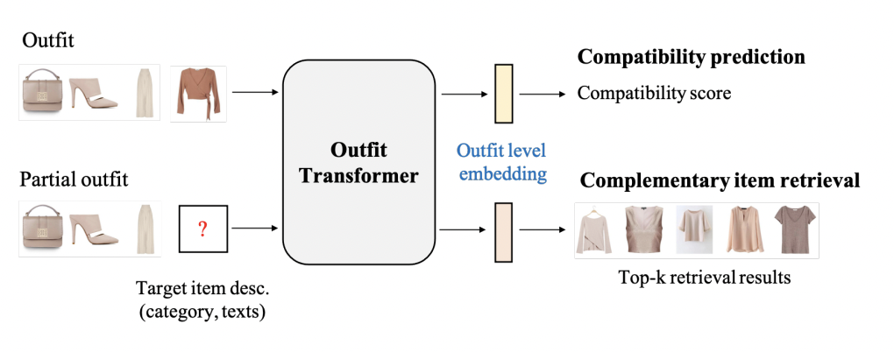
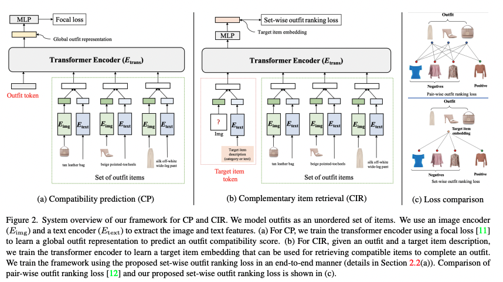

# OutfitTransformer in PyTorch

This is an implementation of the paper : [OutfitTransformer: Learning Outfit Representations for Fashion Recommendation](https://arxiv.org/abs/2204.04812).

## OutfitTransformer Overview

There are two main tasks for a fashion outfit recommendation system:

- Outfit compatibility prediction (CP)
- Large-scale complementary item retrieval (CIR)

Given an outfit, we want to predict how well its constituent items go together. Also, given a partial outfit (such as a bag, shoes, and pants) and a target item description (e.g., “top”), we want to retrieve compatible items to complete the outfit.

Difference with the original paper:

### OutfitTRansformer Model in Details

#### High-Level Model



#### Model Architecture



## Project Structure

```
├── README.md
├── environment.yml
├── src
│   ├── data
│   │   └── outfit_dataset.py
│   ├── models
│   │   ├── ImageTextEncoders.py
│   │   ├── models.py
│   │   ├── OutfitTransformer.py
│   │   └── TransformerEncoder.py
│   ├── train_cp.py
│   └── utils
│       └── loss.py
└── runs
```

- **src/data/** - data loading files
- **src/models/** - model architecture files
- **src/utils/** - utils files (losses, Transforms, metrics,...etc)

- **src/train_cp.py** - Training script for CP task
- **runs/** - folder where expriments weights are stored

## Environment

```
conda env create -f environment.yml
conda activate outfit
```

## Usage

### CP Training

```bash
python src/train_cp.py --datadir ../polyvore_OT --epochs 30 --batch_size 50 --model_name resnet18 --dim_embed 32 --mha_heads 4 --text_feature_dim 768
```

### Save Embeddings for Retrieval

```bash
python src/save_embeddings.py --datadir ../polyvore_OT --dim_embed 32 --mha_heads 4 --text_feature_dim 768 --pretrained CP_pretrained_model
```

### CIR Training

```bash
python src/train_cir.py --datadir ../polyvore_OT --epochs 1 --batch_size 50 --model_name resnet18 --dim_embed 32 --mha_heads 4 --text_feature_dim 768 --pretrained CP_pretrained_model
```
