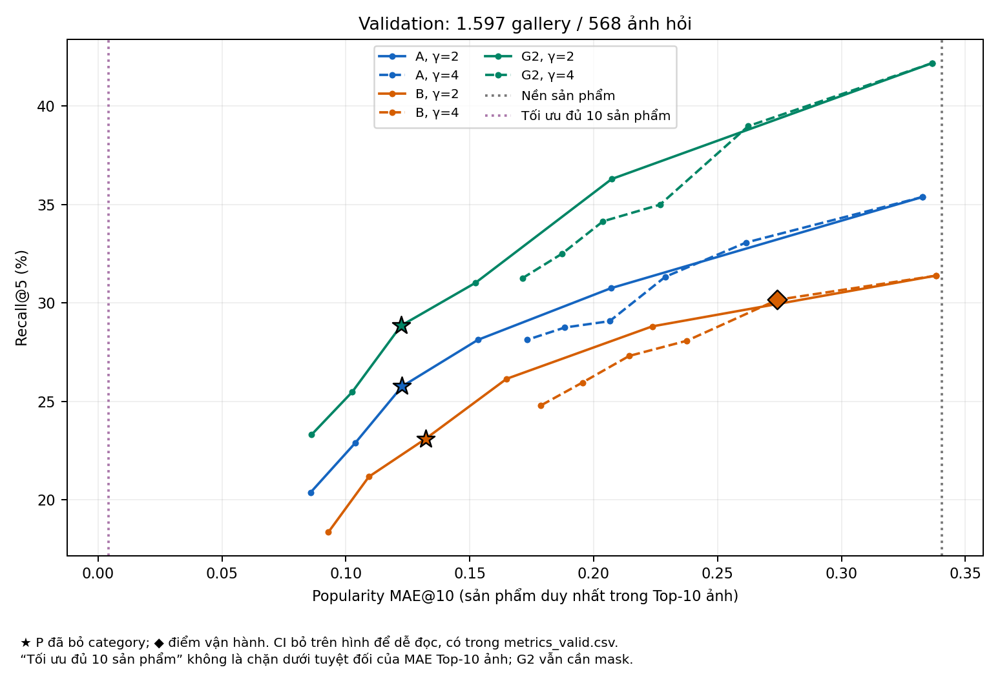
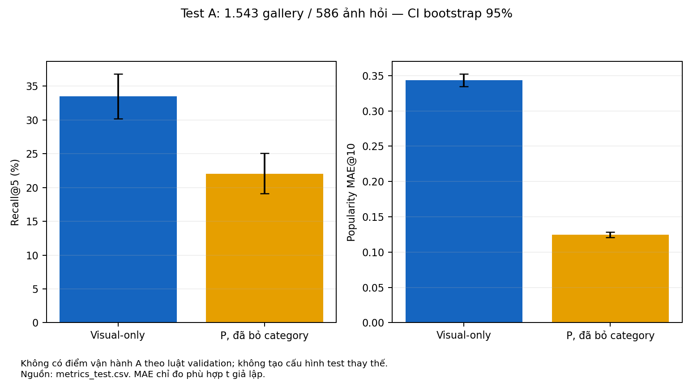
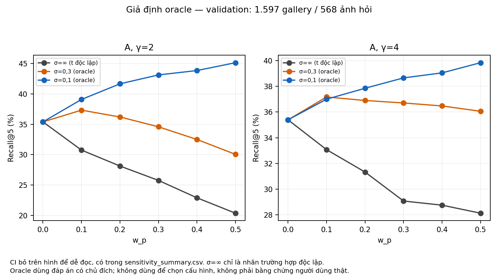

# Kết quả tuần 06 — visual và popularity giả lập

## Công việc đã thực hiện

Em giữ A=B2-v1 làm baseline chính (mapping mask sai ngữ nghĩa), B=B2-v2 đối chiếu; G2 ảnh gốc trong bbox C chỉ tham chiếu và vẫn cần mask. Chỉ khảo sát visual + popularity, không category, không đổi split/backbone/seed. Phạm vi dữ liệu:

| Tập | Gallery | Ảnh hỏi |
|---|---:|---:|
| Validation | 1.597 | 568 |
| Test | 1.543 | 586 |
 Mọi metric dưới đây có điều kiện trên các tập này. Popularity và t là giả lập, không kết luận lượt mua hay sở thích.

## Thiết kế và kiểm tra

Protocol bất biến: `protocol_week6.md`, SHA-256 `3693757e73a8bd24f176a721d8d77a5bb53f4a8e0f43d34cc3edb7cf6c849c5f`. Em chuyển wc sang wv theo quy tắc đã chốt, giữ wp/gamma; gốc chỉ lưu lịch sử. P (.7,.3,0), γ=2; tuần3 đã bỏ category (.7,.3,0), γ=4; §4.5 đã bỏ category (.8,.2,0), γ=2 theo mặc định §4.2. Cả ba trùng lưới, không chạy hai lần. Paper không công bố wc số ở §4.5; không khẳng định wc=.1 là số nguồn. Nguồn và dòng: `paper_source_week6.md`, bảng protocol.

Cosine không rescale; xếp giảm dần stable theo gallery, giữ các góc ảnh riêng. MAE@K gộp sản phẩm duy nhất trong Top-K ảnh rồi macro query, không bù thêm sản phẩm. CI95% bootstrap theo query; hiệu ghép cặp dùng cùng resample. Top1 là Hit1, Recall1 có mẫu số số ảnh đáp án.

Kiểm tra wp0 tái tạo chính xác sáu cột từng dòng Top10 và metric/CI nguồn: `baseline_reproduction_valid.json`, `baseline_reproduction_test.json`. G2 không có MAE lịch sử nên MAE G2 chỉ được kiểm độc lập. Mã độc lập kiểm toàn bộ query ở ba điểm/base validation, mọi cấu hình A test; metric/CI/hiệu được kiểm toàn bộ cấu hình chính thức. Oracle và mức tham chiếu được kiểm riêng. Không có tăng Recall rõ rệt theo tiêu chí dừng đặt trước (CI hiệu dương hoàn toàn so wp0 hoặc bước liền kề); xem `monotonicity_valid.csv`. Không coi gần đơn điệu là bằng chứng độc lập tuyệt đối.

## Lưới validation

Validation: 1.597 gallery / 568 ảnh hỏi. Bảng tỉ lệ 0–1, CI95%. Toàn bộ metric ở metrics_valid.csv; γ=4 tại wp0 là alias γ=2.

| Base | wp | γ | Recall@5 [CI] | MAE@10 [CI] |
|---|---:|---:|---|---|
| A | 0.0 | 2 | 0.35390 [0.31908; 0.38869] | 0.33279 [0.32371; 0.34169] |
| A | 0.1 | 2 | 0.30754 [0.27389; 0.34116] | 0.20702 [0.20126; 0.21273] |
| A | 0.1 | 4 | 0.33072 [0.29659; 0.36500] | 0.26151 [0.25535; 0.26764] |
| A | 0.2 | 2 | 0.28129 [0.24893; 0.31455] | 0.15333 [0.14898; 0.15760] |
| A | 0.2 | 4 | 0.31329 [0.27944; 0.34755] | 0.22890 [0.22365; 0.23410] |
| A | 0.3 | 2 | 0.25764 [0.22536; 0.29010] | 0.12271 [0.11912; 0.12633] |
| A | 0.3 | 4 | 0.29077 [0.25766; 0.32426] | 0.20645 [0.20164; 0.21129] |
| A | 0.4 | 2 | 0.22902 [0.19836; 0.26032] | 0.10389 [0.10073; 0.10711] |
| A | 0.4 | 4 | 0.28754 [0.25487; 0.32129] | 0.18836 [0.18396; 0.19281] |
| A | 0.5 | 2 | 0.20369 [0.17472; 0.23374] | 0.08575 [0.08320; 0.08840] |
| A | 0.5 | 4 | 0.28130 [0.24850; 0.31450] | 0.17320 [0.16917; 0.17727] |
| B | 0.0 | 2 | 0.31388 [0.28104; 0.34713] | 0.33806 [0.32853; 0.34758] |
| B | 0.1 | 2 | 0.28810 [0.25575; 0.32123] | 0.22360 [0.21836; 0.22903] |
| B | 0.1 | 4 | 0.30160 [0.26918; 0.33470] | 0.27411 [0.26777; 0.28060] |
| B | 0.2 | 2 | 0.26147 [0.23037; 0.29359] | 0.16486 [0.16092; 0.16885] |
| B | 0.2 | 4 | 0.28083 [0.24919; 0.31354] | 0.23763 [0.23248; 0.24289] |
| B | 0.3 | 2 | 0.23096 [0.20117; 0.26167] | 0.13216 [0.12919; 0.13531] |
| B | 0.3 | 4 | 0.27310 [0.24220; 0.30582] | 0.21435 [0.20978; 0.21909] |
| B | 0.4 | 2 | 0.21171 [0.18286; 0.24169] | 0.10929 [0.10679; 0.11180] |
| B | 0.4 | 4 | 0.25958 [0.22873; 0.29118] | 0.19547 [0.19147; 0.19944] |
| B | 0.5 | 2 | 0.18353 [0.15587; 0.21230] | 0.09294 [0.09068; 0.09520] |
| B | 0.5 | 4 | 0.24780 [0.21762; 0.27925] | 0.17850 [0.17487; 0.18222] |
| G2 | 0.0 | 2 | 0.42193 [0.38616; 0.45895] | 0.33667 [0.32788; 0.34563] |
| G2 | 0.1 | 2 | 0.36299 [0.32865; 0.39914] | 0.20728 [0.20209; 0.21256] |
| G2 | 0.1 | 4 | 0.38986 [0.35486; 0.42650] | 0.26237 [0.25650; 0.26823] |
| G2 | 0.2 | 2 | 0.31029 [0.27662; 0.34522] | 0.15235 [0.14873; 0.15603] |
| G2 | 0.2 | 4 | 0.34996 [0.31510; 0.38579] | 0.22677 [0.22184; 0.23174] |
| G2 | 0.3 | 2 | 0.28848 [0.25532; 0.32298] | 0.12228 [0.11929; 0.12529] |
| G2 | 0.3 | 4 | 0.34150 [0.30722; 0.37715] | 0.20376 [0.19956; 0.20801] |
| G2 | 0.4 | 2 | 0.25473 [0.22291; 0.28806] | 0.10254 [0.10015; 0.10496] |
| G2 | 0.4 | 4 | 0.32503 [0.29114; 0.36071] | 0.18722 [0.18340; 0.19112] |
| G2 | 0.5 | 2 | 0.23309 [0.20234; 0.26590] | 0.08617 [0.08404; 0.08836] |
| G2 | 0.5 | 4 | 0.31270 [0.27870; 0.34767] | 0.17139 [0.16780; 0.17496] |

Thang cosine validation: 1.597 gallery / 568 ảnh hỏi, lấy ứng viên visual-only. SD popularity trên toàn cặp query–gallery; chi tiết số hạng nhân wp trong scale_valid.csv. Thang khác nhau nên cùng wp không bảo đảm cùng mức tác động giữa các base.

| Base | Cos Top1 min / median / max | Cos Top10 min / median / max | SD popularity γ2 / γ4 |
|---|---|---|---|
| A | 0.36509 / 0.85794 / 1.00000 | 0.33143 / 0.82267 / 1.00000 | 0.19896 / 0.13655 |
| B | 0.57509 / 0.79495 / 0.99606 | 0.53306 / 0.74720 / 0.99606 | 0.19896 / 0.13655 |
| G2 | 0.59213 / 0.87788 / 0.99993 | 0.53899 / 0.83856 / 0.99993 | 0.19896 / 0.13655 |

## Điểm vận hành và độ nhạy ngưỡng

Validation: 1.597 gallery / 568 ảnh hỏi. Chọn theo ngưỡng cố định 2 điểm phần trăm; ngưỡng 1/3 chỉ mô tả. Trong các điểm đạt, ưu tiên wp lớn nhất, rồi MAE10 thấp hơn, rồi γ2. Không có điểm nghĩa là không có wp>0 đạt, không tự gọi wp0 là điểm vận hành.

| Base | Ngưỡng 1 điểm | Ngưỡng 2 điểm (chính) | Ngưỡng 3 điểm |
|---|---|---|---|
| A | không có điểm vận hành | không có điểm vận hành | wp=0.1, γ=4 |
| B | không có điểm vận hành | wp=0.1, γ=4 | wp=0.1, γ=2 |
| G2 | không có điểm vận hành | không có điểm vận hành | không có điểm vận hành |

## Test xác nhận sau freeze

Test: 1.543 gallery / 586 ảnh hỏi. Test chạy một lượt cho các cấu hình đóng băng; không dùng test để chọn. Test đã được quan sát ở tuần trước nên không phải một holdout chưa từng thấy. A không có điểm vận hành nên chỉ hai cấu hình test A. B và G2 xem metrics_test.csv.

| A | Top1 [CI] | Recall@5 [CI] | NDCG@5 [CI] | MRR@10 [CI] | MAE@5 [CI] | MAE@10 [CI] |
|---|---|---|---|---|---|---|
| Visual-only | 0.30887 [0.27304; 0.34471] | 0.33511 [0.30196; 0.36820] | 0.31268 [0.28282; 0.34325] | 0.37622 [0.34176; 0.41101] | 0.34263 [0.33209; 0.35335] | 0.34367 [0.33486; 0.35246] |
| P của paper, đã bỏ category | 0.19283 [0.16212; 0.22526] | 0.22010 [0.19092; 0.25056] | 0.20182 [0.17468; 0.22985] | 0.24393 [0.21336; 0.27514] | 0.11964 [0.11517; 0.12427] | 0.12470 [0.12109; 0.12840] |
| Điểm vận hành | không có | — | — | — | — | — |

Hiệu P−visual A, test 1.543 gallery / 586 ảnh hỏi, CI95% ghép cặp:

| Metric | Hiệu [CI] |
|---|---|
| Recall@5 | -0.11501 [-0.14352; -0.08638] |
| NDCG@5 | -0.11085 [-0.13510; -0.08705] |
| MRR@10 | -0.13230 [-0.15945; -0.10565] |
| MAE@5 | -0.22299 [-0.23415; -0.21181] |
| MAE@10 | -0.21897 [-0.22862; -0.20945] |

Em đối chiếu Top-1 của từng cấu hình với visual-only cùng base bằng kiểm định McNemar. Bảng dưới giữ nguyên số liệu trong `mcnemar_test.csv`.

| Base | wp | γ | n01 | n10 | p_exact |
|---|---:|---:|---:|---:|---:|
| A | 0.0 | 2 | 0 | 0 | 1.0 |
| A | 0.3 | 2 | 11 | 79 | 7.773760769513266e-14 |
| B | 0.0 | 2 | 0 | 0 | 1.0 |
| B | 0.3 | 2 | 17 | 75 | 7.292898576420451e-10 |
| B | 0.1 | 4 | 2 | 11 | 0.0224609375 |
| G2 | 0.0 | 2 | 0 | 0 | 1.0 |
| G2 | 0.3 | 2 | 16 | 107 | 1.042849477691437e-17 |

Mức tham chiếu MAE (không phải cấu hình được chọn). Nền sản phẩm chính tính cả sản phẩm query; nền theo ảnh và bản loại sản phẩm query được báo để tránh lẫn mẫu số. “Tối ưu đủ 10 sản phẩm” là ràng buộc khác MAE Top10 ảnh; bản loại query còn loại ứng viên hợp lệ. Chặn dưới tuyệt đối là lỗi nhỏ nhất trên một sản phẩm khả dụng.

| Tập (gallery / ảnh hỏi) | Tham chiếu | MAE [CI] |
|---|---|---|
| valid (1597 / 568) | gallery_image_mean | 0.33459 [0.32834; 0.34092] |
| valid (1597 / 568) | gallery_product_mean | 0.34044 [0.33448; 0.34637] |
| valid (1597 / 568) | gallery_product_excluding_query | 0.34043 [0.33447; 0.34637] |
| valid (1597 / 568) | closest10_products_including_query | 0.00424 [0.00411; 0.00438] |
| valid (1597 / 568) | closest10_products_excluding_query | 0.00425 [0.00411; 0.00438] |
| valid (1597 / 568) | absolute_lower_bound_one_product | 0.00246 [0.00234; 0.00258] |
| test (1543 / 586) | gallery_image_mean | 0.33833 [0.33239; 0.34434] |
| test (1543 / 586) | gallery_product_mean | 0.33632 [0.33030; 0.34257] |
| test (1543 / 586) | gallery_product_excluding_query | 0.33629 [0.33026; 0.34253] |
| test (1543 / 586) | closest10_products_including_query | 0.00433 [0.00419; 0.00447] |
| test (1543 / 586) | closest10_products_excluding_query | 0.00433 [0.00419; 0.00447] |
| test (1543 / 586) | absolute_lower_bound_one_product | 0.00251 [0.00240; 0.00263] |

## Độ nhạy theo giả định oracle

Chỉ A, validation 1.597 gallery / 568 ảnh hỏi. Dùng pop đáp án cộng nhiễu hash theo query và σ rồi clip: oracle có chủ đích, không dùng để chọn hoặc chạy test. σ=∞ chỉ là tên trường hợp t chính thức độc lập, không phải giới hạn Gaussian sau clip. Bảng bên dưới giữ điểm P đã định trước để đặt các giả định cạnh nhau, không chọn điểm tốt nhất từ oracle.

| Trường hợp (wp=.3, γ2) | σ | Recall@5 [CI] | Hiệu Recall@5 [CI] | MAE@10 [CI] |
|---|---|---|---|---|
| official | ∞ | 0.25764 [0.22536; 0.29010] | -0.09626 [-0.12444; -0.06945] | 0.12271 [0.11912; 0.12633] |
| oracle | 0.3 | 0.34586 [0.31089; 0.38023] | -0.00805 [-0.03208; +0.01580] | 0.12610 [0.12255; 0.12971] |
| oracle | 0.1 | 0.43119 [0.39486; 0.46696] | +0.07728 [+0.05841; +0.09763] | 0.11527 [0.11211; 0.11843] |

Dưới giả định σ=.1, CI hiệu Recall5 dương ở mọi wp>0 của lưới. Dưới giả định σ=.3, γ4 mọi wp>0 và γ2 tại wp=.1/.2/.3 có CI chứa 0 hoặc dương; γ2 tại wp=.4/.5 có CI âm. CI chứa0 chỉ là chưa phát hiện giảm, không chứng minh tương đương/không giảm. Đây là phân tích giả định, không gọi là “popularity giúp ích”. Toàn bộ MAE5/10 và hiệu/CI ở sensitivity_summary.csv; kiểm độc lập ở independent_oracle_checks.csv.

## Giới hạn

Đường đánh đổi quan sát được phù hợp kỳ vọng từ popularity/t giả lập độc lập: thêm thông tin về độ dốc và mức chịu đựng của luật vận hành, không xác nhận cơ chế người dùng. Oracle cho thấy kết luận thay đổi theo giả định liên hệ t–đáp án. G2 cần mask, không phải pipeline không mask. B0 so ngẫu nhiên chỉ mô tả, không chạy B0 mới ở tuần6.

CI chỉ phản ánh lấy mẫu query có điều kiện trên một gallery/split/seed; không bao phủ biến thiên người dùng hoặc dữ liệu khác. Có nhiều phép so sánh, xem mcnemar_bonferroni.csv và paired_bonferroni.csv; CI Bonferroni dùng đuôi bootstrap rất thưa nên không dựa vào chúng cho khẳng định mạnh. Luật 2 điểm là lựa chọn chủ quan, kết quả A/B đổi khi nới ngưỡng. Xem phan_bien_tuan_06.md và phản biện độc lập kèm xử lý.

Chưa kiểm tra được: nhu cầu/lượt mua thật, category chuẩn do người xác nhận, nhiều split/seed/gallery, cơ chế mask, peak RAM toàn đợt. Không suy từ MAE sang sở thích. Không tái lập đầy đủ thí nghiệm paper (dữ liệu, category và mô phỏng khác).

## Minh chứng và tái chạy

Xem manifest_tuan06.json, doi_chieu_so_lieu_tuan06.csv, verification_tuan06.txt, commands_tuan06.txt và muc_luc_goi_tuan06.md. Mã nguồn chỉ nằm tuần6; không sửa tuần1–5/5b/5c. Không chạy lại pipeline vào thư mục bàn giao: các bước dùng tạo file độc quyền, test có marker ngăn lần chạy thứ hai. Khi tái lập, dùng workspace bản sao giữ cấu trúc và dữ liệu nguồn đúng hash, thư mục output mới. Bootstrap kiểm chứng lại không phải một lần chọn/test mới.

Quy tắc thực hiện: loại trùng gamma tại wp0 và điểm có tên; bổ sung bản tham chiếu theo ảnh/sản phẩm và chặn dưới đúng cho metric thực; §4.5 gamma mặc định được ghi trước khi chạy. Không tạo cấu hình vận hành thay thế khi luật không có điểm. Cách đọc cấu hình tuần3 đã được chốt.

Giới hạn được bổ sung sau phản biện độc lập: Timestamp/marker nội bộ không chứng thực độc lập mọi lần thực thi ngoài hồ sơ; hồ sơ hiện có nhất quán với freeze trước lượt test được ghi nhận. Lần kiểm tra bổ sung chỉ đọc hồ sơ tuần6, nên chỉ xác nhận tính nhất quán nội bộ; chưa xác minh trực tiếp nguồn dataset/vector/paper. Mã kiểm chứng độc lập của em có đọc các nguồn cũ là một lớp kiểm tra khác. Chặn dưới lỗi nhỏ nhất một sản phẩm có thể không đạt được khi yêu cầu đủ10 ảnh, không phải giá trị tối ưu khả thi đã tìm. Không thay số liệu hoặc chạy lại test.
